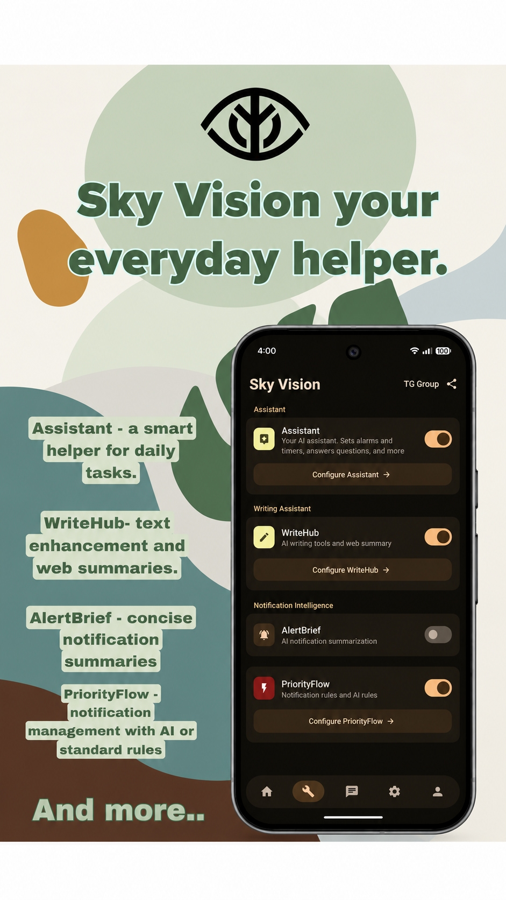
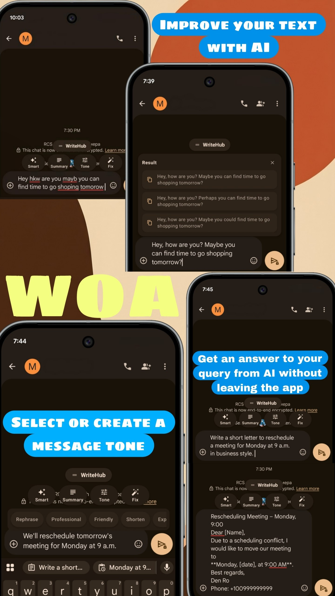
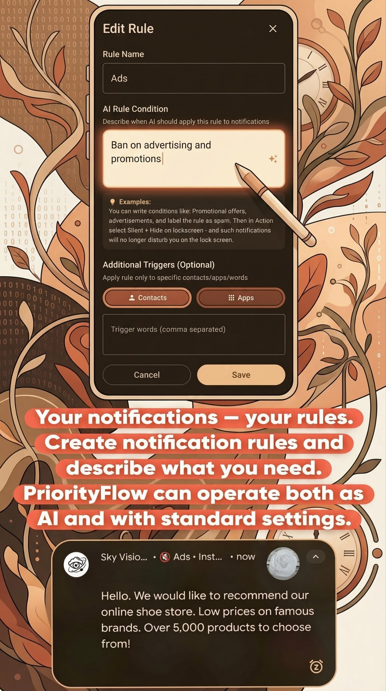
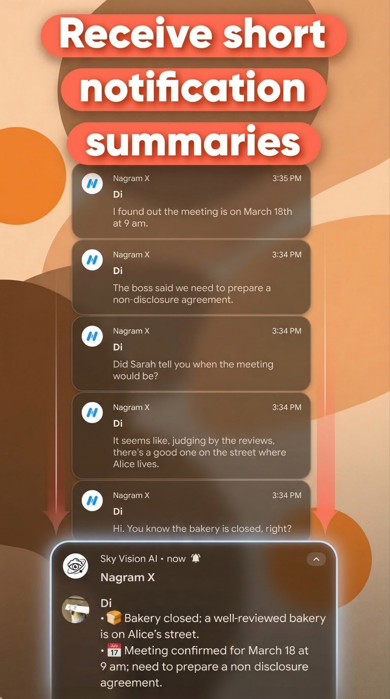
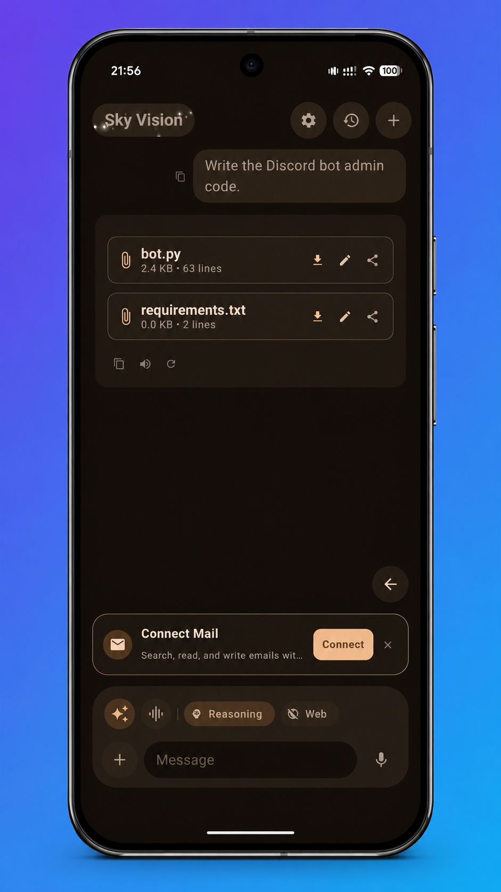
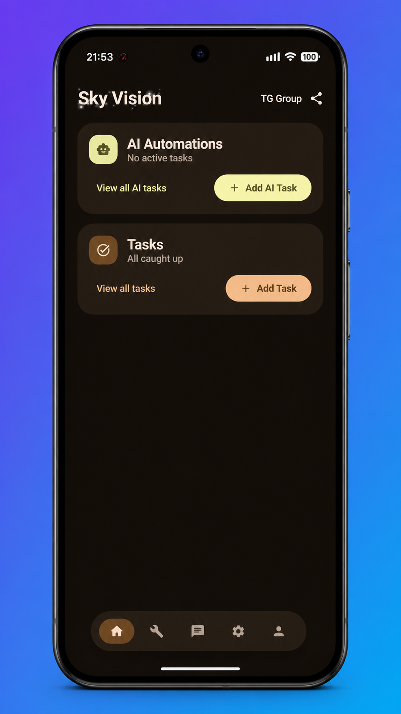

# 
 <b>Sky Vision • AI Agent & Everyday Multitool</b>

  <b>Your personal, intelligent Android assistant ecosystem.</b> 
  Powered by Jetpack Compose, Material 3 Expressive, and state-of-the-art on-device & cloud AI.

  
  &nbsp;&nbsp;
  

  
  
  
  
  

---

## ⚡ Direct Download & Install

| Application | Description | Link |
| :--- | :--- | :--- |
| 🤖 **Sky Vision Agent Module** *(Companion)* | Autonomous on-screen automation, Live Mode, screenshot reasoning & visual AI | [**📥 Download Latest Agent APK**](https://github.com/sasaiber/Sky-Vision-Ai/releases/latest) [Direct APK](https://github.com/sasaiber/Sky-Vision-Ai/releases/latest/download/agentapp-release.apk) • [All Releases](https://github.com/sasaiber/Sky-Vision-Ai/releases) |
| 📱 **Sky Vision Main App** *(Core)* | Smart Assistant, WriteHub, PriorityFlow, AlertBrief, AI Chat & My Space | [**📲 Get on Google Play**](https://play.google.com/store/apps/details?id=com.skytech.skyvision&pcampaignid=web_share) |

> 💡 **Notice:** The **Agent Module** (`com.skytech.skyvision.agent`) is distributed directly on GitHub as an advanced companion APK. It seamlessly connects with the main **Sky Vision** application via local inter-process communication.

---

## 🤖 Sky Vision AI Agent (`agentapp`)

  <i>Autonomous system-level automation, real-time visual reasoning, and conversational Live Mode for your Android device.</i>

The **Sky Vision Agent** is an autonomous AI companion designed to break through the limitations of conventional mobile assistants. While traditional assistants can only answer questions in a closed sandbox, the Sky Vision Agent can perceive your screen, reason about UI elements, and execute workflows across applications on your behalf.

### 🌟 Key Agent Capabilities

* 👁️ **Visual Screen Perception & Multimodal Reasoning:**  
  When enabled, the Agent captures screen context and analyzes the active UI layout (buttons, fields, lists, text) to understand what is happening and plan subsequent actions with precision.
* ⚡ **Autonomous UI Action Execution:**  
  Leverages deep Accessibility API integration to perform taps, inputs, scrolling, and navigation sequences, turning complex multi-step routines into one-tap voice commands.
* 🎙️ **Live Mode & Continuous Ambient Voice:**  
  Hands-free voice control with low-latency streaming audio. Talk to your phone naturally while doing chores, driving, or multitasking.
* 🧩 **Universal Floating Capsule & Overlay:**  
  A non-intrusive Material 3 Expressive floating capsule provides immediate access to agent controls, status indicators, and emergency stops from any screen.
* 🌐 **Multi-Provider AI Freedom:**  
  Configure your preferred model backend:
  * **On-Device:** Local **Gemini Nano** for offline, lightning-fast execution and zero data transmission.
  * **Cloud Leaders:** Google Gemini (1.5 Pro / 2.0 Flash), OpenAI (GPT-4o), Anthropic Claude, OpenRouter, Groq, Cerebras, Puter, Pollinations, or any custom **OpenAI-compatible** endpoint.
* 🔗 **Seamless Core App Integration (`AgentModuleBridge`):**  
  Automatically shares your context, custom prompts, and settings with the main Sky Vision app.

### 🔒 Why Is the Agent Distributed Separately?

1. **Permission & Policy Boundaries:** Advanced OS-level automation requires Accessibility Service and Overlay privileges that Google Play reserves strictly for standalone assistive tools. Distributing the Agent independently on GitHub allows power users to unlock full system automation without compromising the main application's Play Store compliance.
2. **Security & Sandboxing:** Android isolates Accessibility permissions per application package (`com.skytech.skyvision.agent`). You remain in total supervisory control with granular permission toggles and instant emergency cancellations.
3. **Local Privacy:** Credentials, API keys, and captured contexts remain stored exclusively on your device.

---

## ✨ Main Features of Sky Vision (Ecosystem Tour)

Below is an in-depth walkthrough of the core features included in the main Sky Vision application, illustrated in sequential order:

---

### 1. 💬 Smart Assistant & Ambient Capsule
> *Your daily multi-tool and on-screen intelligence hub.*

  

* **Everyday Command Center:** Make phone calls, compose emails and SMS, configure alarms, set timers, take quick notes, and ask ad-hoc questions.
* **Instant Screen & Article Summaries:** Highlight any long article, document, or activate the capsule on any active application to generate an instant, synthesized summary.
* **Material Expressive UI:** Built around tactile, adaptive surfaces that adjust seamlessly to your device's theme and dynamic color palette.

---

### 2. ✍️ WriteHub — In-App Writing Assistant & AI Magic
> *Supercharge your writing directly inside Telegram, WhatsApp, Gmail, and any text field.*

  

* **In-Line AI Chat Inside Input Fields:** Type your prompt directly into WhatsApp or Telegram (e.g. *"write a polite schedule refusal"*), press the WriteHub button, and watch it replace your text with a detailed, human-sounding response.
* **Instant Text Enhancement:** Eliminate typos, correct grammatical structures, and rephrase sentences in a single tap.
* **Adaptive Tone Switching:** Transform your message tone instantly into **Business**, **Friendly**, **Concise**, or **Creative**.
* **Quick Commands (QC):** Create customized keyboard shortcuts (such as `!fc` for real-time web fact-checking). Folders keep your overlay tidy and distraction-free.
* **My Space Autofill:** Instantly insert personal addresses, phone numbers, or recipient details from your private memory vault without app switching.

---

### 3. ⚡ PriorityFlow — Semantic Push Notification Filter
> *Your notifications — your rules. Filter the noise and let only what matters through.*

  

* **Natural Language Semantic Rules:** Describe what you want filtered in plain words (e.g., *"Ban all advertising, promotional sales, and discounts"*).
* **VIP & Urgent Bypass:** Ensure critical emails, urgent family messages, or emergency updates bypass Do Not Disturb mode while suppressing spam.
* **Hybrid Rule Architecture:** Combine flexible semantic AI evaluations with deterministic regex, keyword, contact, and application filters.

---

### 4. 🔔 AlertBrief — Smart Notification Summaries
> *Stop drowning in notification spam. Get clear, synthesized digests in seconds.*

  

* **Intelligent Message Aggregation:** Group rapid-fire messages from chat applications into structured, readable digests.
* **Actionable Key Takeaways:** Distills 20+ fragmented messages into 2 concise bullets, highlighting deadlines, decisions, and meeting locations at a glance.

---

### 5. 🗨️ AI Chat & Code Generation
> *Deep reasoning conversations, file creation, and native email integration.*

  

* **Deep Problem Solving:** Dedicated chat workspace equipped with Reasoning mode, live Web Search toggles, and multi-turn contextual memory.
* **Code & File Generation:** Request complex scripts (e.g., Discord admin bot in Python) and receive ready-to-run files (`bot.py`, `requirements.txt`) that you can download, edit, and share directly from chat.
* **Integrated Email Agent:** Read email threads, generate contextual reply drafts, and send correspondence to multiple recipients using natural voice instructions.

---

### 6. 🤖 AI Automations & Daily Tasks
> *Put routine routines on autopilot with proactive AI scheduling.*

  

* **Scheduled Background Automations:** Configure routine AI workflows that execute automatically in the background at designated hours.
* **Unified Tasks & Reminders:** An integrated manager that connects your voice assistant, chat sessions, and notes into synchronized daily tasks.

---

## 🧠 My Space — Unified Intellectual Memory

**My Space** is the connective brain linking the Assistant, WriteHub, AI Agent, and Chat into a cohesive intelligence:

* **Context Awareness:** Stores your personal preferences, frequently used project guidelines, and key contacts with custom attributes (addresses, phone numbers, notes, email writing styles).
* **Zero Repetition:** The AI remembers your context so you never have to re-explain who your colleagues are or what your address is.
* **Smart Autofill:** Automatically completes forms, documents, and email templates using your verified data.

---

## 🔒 Privacy & On-Device Security

Sky Vision is designed with a **privacy-first, local-first** architecture:

* **Strict Local Storage:** Your chat history, API keys, custom rules, notes, and My Space credentials are saved exclusively within private on-device storage.
* **Local Gemini Nano Support:** Compatible devices can run select AI features completely offline, ensuring zero personal data ever leaves your device.
* **Explicit Permissions:**
  * **Accessibility Service:** Used strictly by WriteHub and the Agent module to detect input fields and assist with user-authorized text insertion and screen actions.
  * **Microphone & Overlay:** Only active when user triggers voice input, Live Mode, or the floating capsule.

---

## 🚀 Getting Started

### 1. Install Sky Vision (Main App)
Download from Google Play:
👉 [**Sky Vision on Google Play Store**](https://play.google.com/store/apps/details?id=com.skytech.skyvision&pcampaignid=web_share)

### 2. Install the Sky Vision Agent Companion (Optional)
To enable autonomous on-screen actions and Live Mode:
1. Download the latest `agentapp-release.apk` from [**GitHub Releases**](https://github.com/sasaiber/Sky-Vision-Ai/releases/latest).
2. Install the APK on your Android device (allow installation from unknown sources if prompted).
3. Open the Agent app and grant the required Accessibility and Overlay permissions.
4. Return to Sky Vision — the applications will automatically pair via `AgentModuleBridge`.

---

  Developed by <b>SkyTech</b> • Built with Jetpack Compose & Material 3 Expressive 
  <a href="PrivacyPolicy.md">Privacy Policy</a> • <a href="TermsOfService.md">Terms of Service</a> • <a href="DATA_DELETION.md">Data Deletion</a>

